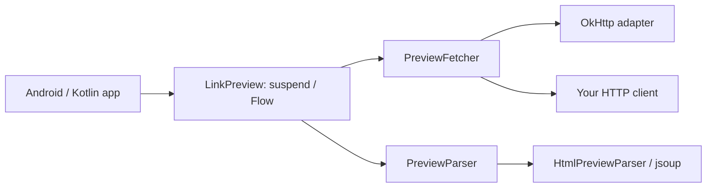

# LinkPreview

Link metadata for Android and Kotlin/JVM: a coroutine API, a cold Kotlin Flow, and a network layer you control.

Extract a page's title, description, images, canonical URL, site name, and favicon. Use the optional OkHttp adapter with your existing client, or supply your own transport. The core has no Android framework or OkHttp dependency.

## Modules

| Gradle module | Purpose |
| --- | --- |
| `:link-preview` | Kotlin/JVM models, `suspend` loader, Flow states, and jsoup HTML parser |
| `:link-preview-okhttp` | Optional cancellable OkHttp transport; includes the core transitively |
| `:app` | Android sample with Compose Material 3, a ViewModel, StateFlow, lifecycle-aware collection, and Coil images |



## Installation

### Work from this repository

The sample already depends on `:link-preview-okhttp`. Other modules in this build can use:

```kotlin
dependencies {
    implementation(project(":link-preview-okhttp"))
    // Or use only :link-preview when supplying your own transport.
}
```

### Use a local snapshot in another project

Publish both modules to your local Maven repository:

```shell
bash ./gradlew -PincludeAndroidSample=false publishToMavenLocal
```

Add `mavenLocal()` alongside `google()` and `mavenCentral()` in the consuming project's dependency repositories, then use:

```kotlin
dependencies {
    implementation("io.github.siarheisinelnikau:link-preview-okhttp:2.0.0-SNAPSHOT")
    // Custom transport only:
    // implementation("io.github.siarheisinelnikau:link-preview:2.0.0-SNAPSHOT")
}
```

These coordinates resolve after local publication. A public release requires a separate publishing setup.

Android apps that fetch pages need this permission in their **application** manifest:

```xml
<uses-permission android:name="android.permission.INTERNET" />
```

`ACCESS_NETWORK_STATE` is not required by the library. The sample uses HTTPS; Android's cleartext policy still applies to HTTP links.

### Android Java API compatibility

[jsoup requires core library desugaring with NIO support on Android](https://jsoup.org/download#android-support). Enable it in the consuming **application** module (the sample already does this):

```kotlin
android {
    compileOptions {
        isCoreLibraryDesugaringEnabled = true
    }
}

dependencies {
    coreLibraryDesugaring("com.android.tools:desugar_jdk_libs_nio:2.1.5")
}
```

## Load with coroutines

```kotlin
import com.link.preview.LinkPreview
import com.link.preview.Preview
import com.link.preview.okhttp.OkHttpPreviewFetcher

// Keep and reuse a loader, ideally with your app's shared OkHttpClient.
val loader = LinkPreview(fetcher = OkHttpPreviewFetcher())

suspend fun previewLink(): Preview {
    return loader.load("Read this: https://kotlinlang.org")
}
```

`load()` accepts an absolute HTTP(S) URL or text containing one and loads the first valid URL. Schemes such as `file:` and `javascript:`, URLs containing credentials, and invalid ports are rejected. Supply explicit `https://` or `http://`; bare domain names are not expanded. Internationalized domain names should use their ASCII/punycode representation.

When the entire input is a valid URL, its trailing punctuation is preserved (for example, `https://example.com/search?q=Hello!`). URLs extracted from surrounding text have trailing sentence punctuation and unmatched closing brackets removed; balanced parentheses and IPv6 brackets are retained.

Fetching and parsing run on `Dispatchers.IO` by default, so `load()` can be called from the main thread. A dispatcher can be injected for tests. The caller owns the coroutine scope; cancelling it cancels an active OkHttp call, including body reads.

The returned `Preview` contains:

| Property | Meaning |
| --- | --- |
| `url` | The URL extracted from the input |
| `finalUrl` | The actual response URL after redirects |
| `title` | Open Graph, Twitter, HTML title, heading, or hostname fallback |
| `description` | Metadata, first nonempty paragraph, or visible body text |
| `imageUrls` | Distinct resolved HTTP(S) URLs, metadata first, then HTML images |
| `canonicalUrl` | Canonical link, falling back to `og:url`; nullable |
| `siteName` | `og:site_name` or application name; nullable |
| `faviconUrl` | An explicit icon link; nullable |

## Observe with Kotlin Flow

```kotlin
import com.link.preview.PreviewState

// Inside a lifecycle-owned coroutine, such as viewModelScope.launch { ... }:
loader.observe("https://kotlinlang.org").collect { state ->
    when (state) {
        PreviewState.Loading -> showLoading()
        is PreviewState.Success -> showPreview(state.preview)
        is PreviewState.Error -> showError(state.cause)
    }
}
```

`showLoading`, `showPreview`, and `showError` represent your UI callbacks. See the complete [sample ViewModel](app/src/main/kotlin/com/link/preview/sample/PreviewViewModel.kt) and [Compose screen](app/src/main/kotlin/com/link/preview/sample/MainActivity.kt).

Each collection performs a new request and emits `Loading`, then either `Success` or `Error`. The flow does not cache or share results. Use `stateIn`, `shareIn`, or an application cache when sharing is needed. Cancelling collection propagates cancellation; it does not emit `Error`. Exceptions thrown by the collector and fatal JVM errors also propagate.

For interactive input, cancel the previous job or use `flatMapLatest` to discard obsolete requests. The sample cancels an existing request before starting another and retains input through `SavedStateHandle`.

## Bring your own network client

The core knows only this contract:

```kotlin
fun interface PreviewFetcher {
    suspend fun fetch(request: PreviewRequest): PreviewResponse
}
```

`PreviewRequest` supplies `url`, `headers`, and `maxBodyBytes`. Return raw bytes, the response's actual final URL, HTTP status, and Content-Type. Raw bytes preserve charset information.

This complete in-memory adapter demonstrates the boundary without requiring any HTTP library:

```kotlin
import com.link.preview.LinkPreview
import com.link.preview.PreviewFetcher
import com.link.preview.PreviewResponse

val fetcher = PreviewFetcher { request ->
    PreviewResponse(
        url = request.url,
        body = "<title>From my transport</title>".toByteArray(Charsets.UTF_8),
        contentType = "text/html; charset=utf-8",
        statusCode = 200,
    )
}
val loader = LinkPreview(fetcher = fetcher)
```

Replace the lambda body with your client's request, or implement `PreviewFetcher` in a class. Your adapter must close response resources, bound **decoded** bytes while reading, and connect coroutine cancellation to the underlying request. The loader validates status, final URL, and body size again, but cannot undo an unbounded allocation already made by a custom client. Configure redirects, timeouts, authentication, cookies, and network access policy in that client.

### Reuse OkHttp configuration

```kotlin
import java.util.concurrent.TimeUnit
import okhttp3.OkHttpClient

val client = OkHttpClient.Builder()
    .connectTimeout(10, TimeUnit.SECONDS)
    .readTimeout(10, TimeUnit.SECONDS)
    .callTimeout(20, TimeUnit.SECONDS)
    // Add your interceptors, Cache, CookieJar, proxy, or DNS configuration here.
    .build()

val loader = LinkPreview(
    fetcher = OkHttpPreviewFetcher(client),
    headers = mapOf("User-Agent" to "MyApp/1.0"),
)
```

The adapter uses the supplied client unchanged and never shuts it down. Its default client uses 10-second connect/read timeouts and a 20-second total call timeout. Default headers identify `LinkPreview/2.0` and accept HTML and images; request headers can override them. OkHttp handles redirects according to the client's policy and limits redirect chains.

## Parser options and offline parsing

```kotlin
import com.link.preview.HtmlPreviewParser
import com.link.preview.PreviewResponse

val parser = HtmlPreviewParser(maxImages = 3, maxDescriptionLength = 280)
val loader = LinkPreview(
    fetcher = OkHttpPreviewFetcher(client),
    parser = parser,
    maxBodyBytes = 1024 * 1024,
)

// Parse HTML you already have; no HTTP request is made.
val preview = parser.parse(
    response = PreviewResponse(
        url = "https://example.com/article",
        body = "<title>Offline HTML</title>".toByteArray(),
    ),
    requestedUrl = "https://example.com/article",
)
```

Defaults are 10 images, 500 description characters, and a 2 MiB decoded response-body limit. Description length is counted in Unicode code points, so supplementary characters such as emoji are never split into invalid UTF-16 halves; multi-code-point graphemes may still be split. Set `maxImages = 0` to omit images. Implement `PreviewParser` to replace the extraction strategy entirely. Direct parser calls are synchronous: move large offline parses off the Android main thread and enforce your own input-size limit.

The HTML parser supports Open Graph, Twitter Cards, ordinary metadata, HTML entities, malformed markup, repeated image tags, `<base href>`, relative/protocol-relative URLs, and HTTP/BOM/meta-declared charsets. Query-only references such as `?page=2` keep the current page path. Unknown or malformed HTTP charset declarations fall back to BOM/meta detection, then UTF-8. The final response URL is preserved, including query parameters.

Image URLs are deduplicated and restricted to HTTP(S). Metadata images come first, followed by HTML images in document order. For each ``, the parser chooses the first valid URL from `data-src`, `data-original`, and `src`, so lazy-loaded images take precedence over placeholder sources. Responsive `srcset` selection and images injected by JavaScript are not supported.

Responses with `image/*` Content-Type become image-only previews. The OkHttp adapter closes those responses without buffering image bytes; the image loader in your UI downloads them separately. HTML and XHTML are supported, and absent Content-Type is parsed as HTML. Other explicit content types fail.

This is an HTML metadata reader: it does not execute JavaScript, bypass authentication or bot protection, or render a WebView. Some pages therefore have no useful metadata. No preview cache or retry policy is imposed by the core. Host/private-network restrictions, when needed for your use case, belong in the transport and must account for redirects and DNS resolution.

## Errors

`load()` throws failures; `observe()` exposes ordinary failures as `PreviewState.Error`. Known failures extend `PreviewException`:

| Type | Meaning |
| --- | --- |
| `InvalidUrl` | No usable input URL, or an invalid final URL from a transport |
| `Http` | Non-2xx response; includes `statusCode` and `url` |
| `UnsupportedContentType` | Explicit non-HTML/non-image response type |
| `BodyTooLarge` | Decoded response exceeds `maxBodyBytes` |
| `Network` | Transport `IOException`; the original cause is preserved |

Custom adapters and parsers may throw other exceptions. When handling exceptions yourself, always rethrow `CancellationException`.

## Build and run

Use **JDK 21** and the checked-in Gradle Wrapper. Open the root project in a compatible Android Studio release. The Android sample requires SDK Platform 37 and Build Tools 36.0.0; set `ANDROID_HOME` or `sdk.dir` in an untracked `local.properties`.

```shell
sdkmanager 'platforms;android-37.0' 'build-tools;36.0.0'
bash ./gradlew :link-preview:build :link-preview-okhttp:build :app:assembleDebug :app:lintDebug
bash ./gradlew :app:assembleRelease
```

On Windows, use `gradlew.bat` (or `.\gradlew.bat` in PowerShell). The release sample is unsigned; supply your own signing setup to distribute it.

To build and test just the libraries without an Android SDK:

```shell
bash ./gradlew -PincludeAndroidSample=false :link-preview:build :link-preview-okhttp:build
```

The tests cover parser priorities, lazy-loaded images, charset decoding and recovery, Unicode description limits, URL extraction and resolution, Flow behavior, cancellation, injected transports, redirects, HTTP failures, timeouts, and declared/chunked/gzip body limits. Network integration tests use a local MockWebServer; they do not depend on public websites. [CI](.github/workflows/ci.yml) checks library builds plus Android debug/release builds and lint.

### Toolchain

Versions are pinned in [gradle/libs.versions.toml](gradle/libs.versions.toml), with the distribution pinned in the [Wrapper configuration](gradle/wrapper/gradle-wrapper.properties).

| Component | Version |
| --- | --- |
| Kotlin | 2.4.21 |
| Android Gradle Plugin | 9.4.1, built-in Kotlin enabled |
| Gradle | 9.6.0 |
| kotlinx.coroutines | 1.11.0 |
| jsoup | 1.23.2 |
| OkHttp / MockWebServer | 5.5.1 |
| Compose BOM | 2026.09.00 |
| Activity / Lifecycle | 1.13.0 / 2.11.0 |
| Coil | 3.6.3 |
| Android NIO desugaring | 2.1.5 |
| Android sample | minSdk 23, compileSdk / targetSdk 37 |

The library modules produce Java 8 bytecode; the Android sample targets JVM 17. Android support also depends on the minimum requirements of the dependencies you select; the sample's minimum is Android 6.0.

Compatibility references: [AGP releases](https://developer.android.com/build/releases/about-agp), [Kotlin releases](https://kotlinlang.org/docs/releases.html), [Compose BOM](https://developer.android.com/develop/ui/compose/bom), [jsoup releases](https://jsoup.org/news/), and [OkHttp releases](https://github.com/square/okhttp/releases).

## License and acknowledgements

Copyright 2019 Siarhei Sinelnikau. Licensed under the [Apache License 2.0](LICENSE).

Inspired by [LeonardoCardoso/Android-Link-Preview](https://github.com/LeonardoCardoso/Android-Link-Preview).
